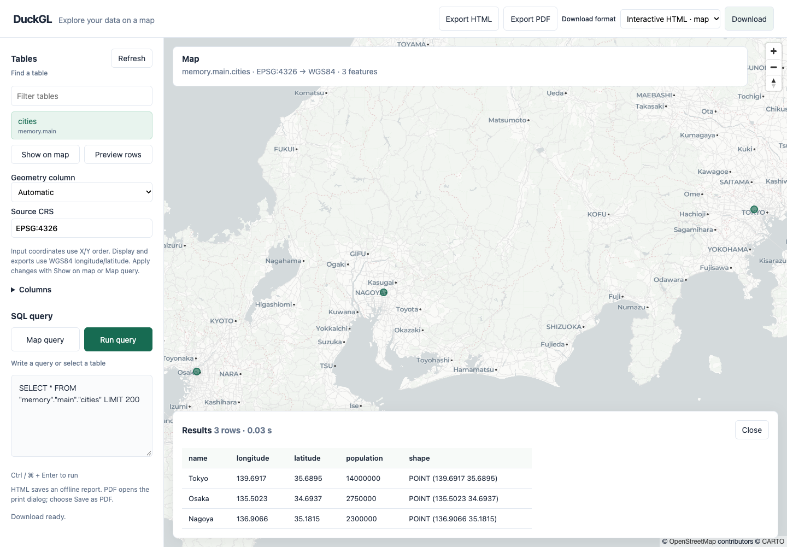

# DuckGL

Explore DuckDB spatial data on an interactive map, run SQL, and export data,
images, and shareable HTML. DuckGL runs a local HTTP server inside DuckDB and
uses MapLibre GL and Deck.gl in your browser.



## Quick start

The source in this repository targets **DuckDB 2.0.0**. Use a matching extension
build; the community package available for your DuckDB version may differ from
this source revision.

```sql
INSTALL spatial;
LOAD spatial;
INSTALL duckgl FROM community;
LOAD duckgl;

CREATE TABLE cities AS
SELECT 'Tokyo' AS name, 14000000 AS population,
       ST_Point(139.6917, 35.6895) AS shape
UNION ALL SELECT 'Osaka', 2750000, ST_Point(135.5023, 34.6937)
UNION ALL SELECT 'Nagoya', 2300000, ST_Point(136.9066, 35.1815);

SELECT duckgl_start('127.0.0.1', 8080);
-- Select cities in the browser sidebar.
-- Keep this DuckDB session open while using the workspace.

-- When finished:
SELECT duckgl_stop();
```

For a locally built extension, replace `INSTALL`/`LOAD duckgl` with
`LOAD './build/release/extension/duckgl/duckgl.duckdb_extension';` and start the
CLI with `duckdb -unsigned` for an unsigned development build.

## Workspace

Select a table to display its geometry. **Preview rows** runs a quoted,
database-qualified `SELECT ... LIMIT 200`. **Run query** executes the SQL editor;
Ctrl/⌘ + Enter is the keyboard shortcut. Result previews show at most 200 rows;
query exports include every row returned by that query, including any explicit
SQL `LIMIT`.

The sidebar shows `database.schema` and searches the database, schema and table
names. Tables with the same name in different attached databases remain distinct.
Use **Refresh** after creating or attaching tables.

### Ten new capabilities

| Capability | How to use it |
|---|---|
| CSV results | Choose **CSV · query**, then **Download**. |
| JSON results | Choose **JSON · query** to retain JSON types. |
| GeoJSON data | Choose **GeoJSON · map** for the last successfully loaded geometry. |
| SVG overview | Choose **SVG · map overview** for editable vector geometry. |
| PNG overview | Choose **PNG · map overview** for a 1000 × 450 image. |
| Interactive HTML map | Choose **Interactive HTML · map** for a shareable, server-independent map. |
| Column inspection and geometry selection | Open **Columns** and select a **Geometry column**. |
| Coordinate system conversion | Set **Source CRS**, then reload the map. |
| SQL results on the map | Write a spatial `SELECT`, then choose **Map query**. |
| Feature inspection | Click a feature to display its complete properties. |

### Geometry columns

DuckGL detects `GEOMETRY` columns by type, including arbitrary names such as
`shape` or `位置`. **Automatic** prefers `geometry`, `geom`, then `the_geom`
(case insensitive), followed by the first geometry column in table order.
A text column named `geometry` is ignored.

To display a different geometry from a table with several geometry columns,
choose it in **Geometry column**, then press **Show on map**. **Columns** lists
all column names and SQL types for the selected table.

### Coordinate accuracy

**Source CRS** defaults to `EPSG:4326`. Enter the coordinate system of your input,
for example `EPSG:3857`, and choose **Show on map** or **Map query**. DuckGL uses
DuckDB spatial's `ST_Transform` to convert to WGS84 longitude/latitude. Coordinate
axis order is explicitly **X/Y**: longitude/latitude for WGS84 and
easting/northing for projected data. The input coordinate system is a user choice;
DuckGL does not infer it from coordinate ranges.

```sql
CREATE TABLE projected_cities AS
SELECT name,
       ST_Transform(shape, 'EPSG:4326', 'EPSG:3857', true) AS shape
FROM cities;
-- Select projected_cities and set Source CRS to EPSG:3857.
```

Use **Source CRS = EPSG:4326** when your SQL already returns WGS84 geometries.
Changing the source CRS changes the map representation and subsequent map
exports; it does not modify the source table.

### Map a SQL query

Queries can filter, join or compute geometries before visualization:

```sql
SELECT name, population, shape
FROM cities
WHERE population >= 2500000
ORDER BY population DESC;
```

Choose **Map query**. It accepts a single `SELECT`, including a `WITH` query,
with at least one `GEOMETRY` result column. If the query renames a geometry
column, choose **Automatic** or a matching column name. Its attributes are the
other result columns. NULL geometries are omitted from the map.

Map queries and tabular queries keep their last successful snapshots separately.
Editing the SQL editor afterward does not change a saved map's SQL provenance
or relabel existing results. Click any rendered feature to inspect values;
Boolean, zero and NULL values remain distinguishable.

## Export formats

**Export HTML** and **Export PDF** create a report. The **Download format** menu
adds data, vector/image and interactive-map exports.

| Format | Contents | Opens offline | Base-map tiles |
|---|---|---|---|
| HTML report | Last successful tabular SQL and all its rows, plus loaded geometry and map SQL when present | Yes | No |
| PDF report | Same report through the browser's print dialog; choose **Save as PDF** | Yes, after saving | No |
| Interactive HTML | Embedded GeoJSON, map label, map SQL and current camera; pan/zoom and inspect features | Internet needed for libraries/tiles; DuckGL server can be stopped | Yes |
| CSV | Last successful tabular result; UTF-8 with BOM, CRLF rows and quoted fields | Yes | — |
| JSON | Last successful tabular result as an array of row objects | Yes | — |
| GeoJSON | Last successful map result as a FeatureCollection, in WGS84 | Yes | No |
| SVG | Geometry overview with north up, polygon holes and vector points/lines | Yes | No |
| PNG | Raster version of the geometry overview, 1000 × 450 pixels | Yes | No |

SVG, PNG and report maps fit the entire geometry in longitude/latitude. They are
geometry overviews; their extent and appearance differ from the interactive
map's current camera and basemap. Interactive HTML keeps the camera when available
and needs no API connection or Mapbox token. It includes the loaded data, so it can
be moved to another machine or served as a static page. Its browser fetches
MapLibre, Deck.gl and public Carto basemap tiles when opened.

CSV represents NULL as an empty field. JSON and GeoJSON retain NULL and Boolean
values. Integer tokens outside JavaScript's safe range
(`-9007199254740991` through `9007199254740991`) are JSON strings, for example
`"9007199254740993"`, to retain every digit. Other finite numeric values use JSON
numbers; non-finite numeric values use JSON null. Floating-point and decimal
values follow normal browser numeric precision.

Saved reports contain no scripts or SQL requests. Interactive HTML includes
scripts for map interaction and safely embeds data, including Japanese, quotes,
and strings containing HTML. Neither type runs the saved SQL when reopened.

## SQL functions

| Function | Result |
|---|---|
| `duckgl_start(host VARCHAR, port INTEGER)` | Starts the server, opens a browser and returns a status message. |
| `duckgl_stop()` | Stops the server, or returns `No server running`. |

Ports must be between 1 and 65535. Use a loopback host such as `127.0.0.1` for a
local workspace. The server shares the running DuckDB database. It accepts SQL
from the workspace/API, so bind it only to an interface you intend to expose.

## HTTP API

All data endpoints return JSON. SQL errors contain an `error` field; map errors
also contain an empty FeatureCollection. Check `error` as well as HTTP status.

| Endpoint | Method | Request / response |
|---|---|---|
| `/` | GET | Map workspace HTML. |
| `/api/tables` | GET | Array of `table_name`, `table_schema`, `table_catalog`. |
| `/api/columns/{table}` | GET | Array of `column_name`, `data_type`, `is_geometry`. |
| `/api/query` | POST | Raw SQL body → array of row objects. |
| `/api/geojson/{table}` | GET | Table → GeoJSON FeatureCollection. |
| `/api/query-map` | POST | Raw single-SELECT SQL body → GeoJSON FeatureCollection. |

`/api/columns/{table}` and `/api/geojson/{table}` accept `schema` (default `main`) and `catalog`
(default the connection's current database). Map endpoints also accept
`geometry` (result/table column name; omitted means automatic) and `source_crs`
(default `EPSG:4326`). URL-encode table path segments and parameter values.

```sh
curl 'http://127.0.0.1:8080/api/columns/cities?schema=main'
curl 'http://127.0.0.1:8080/api/geojson/projected_cities?geometry=shape&source_crs=EPSG%3A3857' > cities.geojson
curl -H 'Content-Type: text/plain' --data-binary \
  'SELECT name, shape FROM cities WHERE population >= 2500000' \
  http://127.0.0.1:8080/api/query-map > selected-cities.geojson
```

## Build and test

A C++17 compiler, CMake, Make, Python 3 and Git are needed for the extension.
Node.js 22 and Playwright are used for browser tests. The pinned DuckDB source is
`d54cbbe3df17e8e5ce68312f483b4155836112aa` (`v2.0.0`).

```sh
git clone --recurse-submodules https://github.com/nkwork9999/duckgl.git
cd duckgl
make release

bash scripts/test-unit.sh
npm ci --prefix test
npx --prefix test playwright install chromium
node test/browser.test.cjs
node test/export.test.cjs
node --test test/features.test.cjs
```

To use installed Chrome, prefix browser commands with `UI_BROWSER_CHANNEL=chrome`.
For real extension-loader, HTTP and spatial tests, see [test/README.md](test/README.md).
Version/build maintenance notes are in [docs/UPDATING.md](docs/UPDATING.md).

## Troubleshooting

| Symptom | Action |
|---|---|
| Spatial extension not available | Run `INSTALL spatial; LOAD spatial;` in the matching DuckDB version. |
| No geometry column | Select a `GEOMETRY` column; inspect **Columns** or use a spatial `SELECT`. |
| Features are outside the expected location | Confirm **Source CRS** and X/Y axis order. |
| Query geometry name differs from the selected table | Choose **Automatic** before **Map query**. |
| Map libraries or tiles fail to load | Restore internet access and reload; tabular queries and offline report/data exports remain usable. |
| Download is disabled | Run a tabular query for CSV/JSON or load geometry for map formats. |
| PDF window does not open | Allow the workspace's pop-up, then choose **Save as PDF** in the print dialog. |
| Extension version mismatch | Use a DuckGL build matching the runtime; this source targets DuckDB 2.0.0. |
| Port already in use | Choose another port or stop the process occupying it. |

## Related tools and references

The export workflow draws on the distinction between interactive HTML, images,
and reusable data described in [kepler.gl's export guide](https://docs.kepler.gl/docs/user-guides/k-save-and-export).
[Miniplot](https://github.com/nkwork9999/miniplot) offers SQL-driven HTML charts;
DuckGL applies a similar shareable-HTML workflow to spatial data.

- [DuckDB spatial functions and CRS transformation](https://duckdb.org/docs/current/core_extensions/spatial/functions)
- [MapLibre GL JS](https://maplibre.org/maplibre-gl-js/docs/)
- [Deck.gl](https://deck.gl/)

## License

MIT — see [LICENSE](LICENSE).
